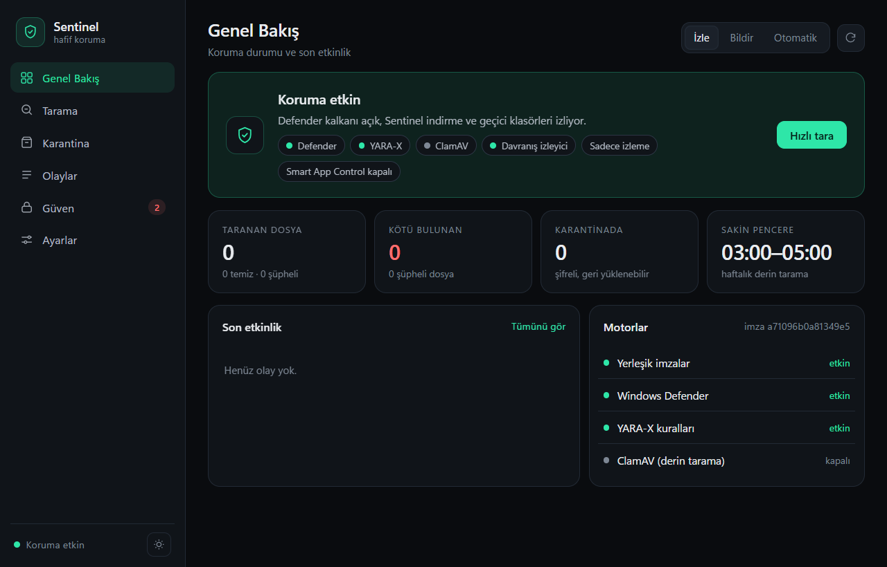
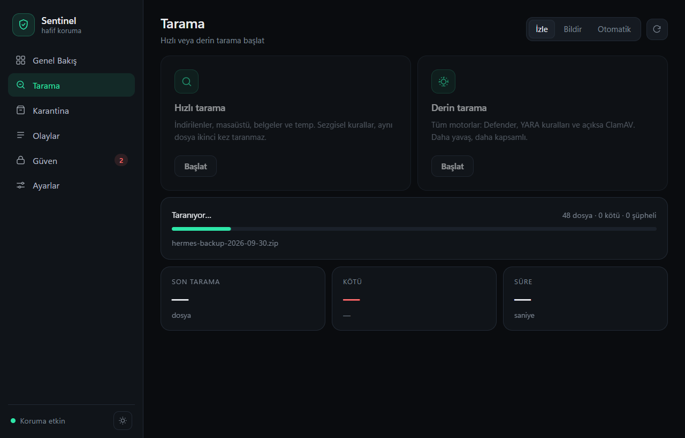
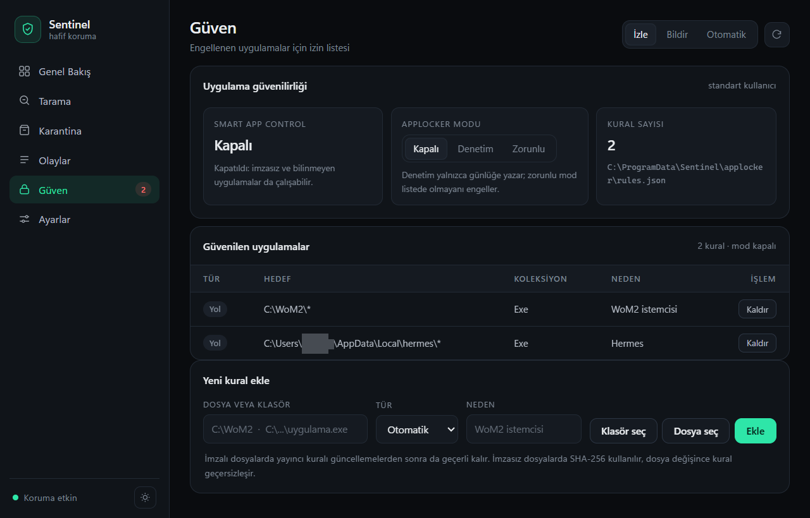
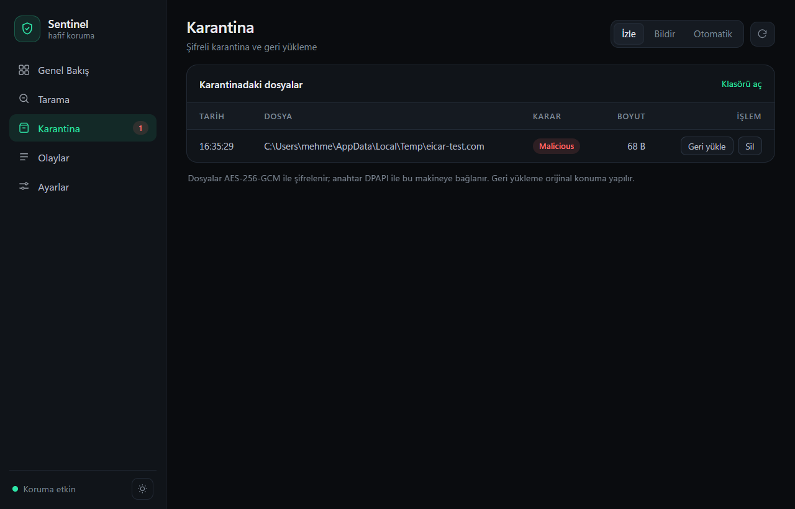
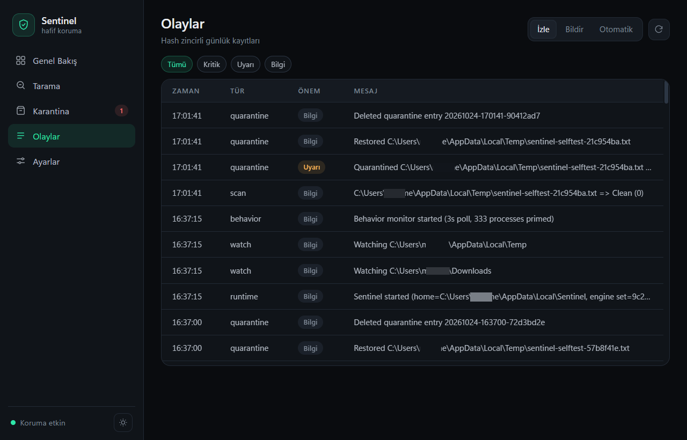
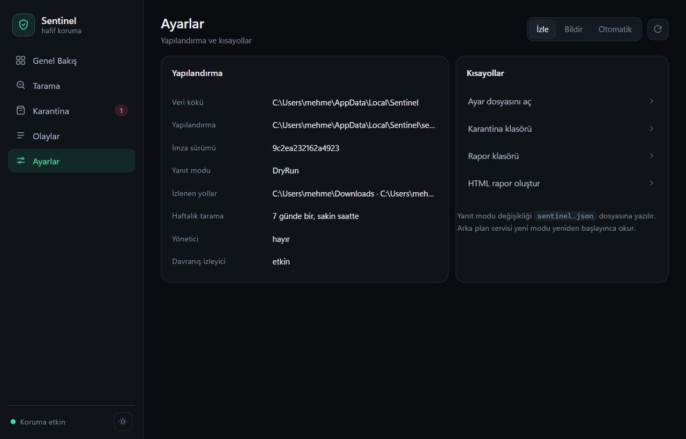

# Sentinel

[](LICENSE)
[](#kurulum)
[](https://dotnet.microsoft.com/download)
[](https://github.com/payidaramelles-sys/sentinel-av/releases)
[](https://github.com/payidaramelles-sys/sentinel-av/actions/workflows/build.yml)

**[⬇ Son sürümü indir](https://github.com/payidaramelles-sys/sentinel-av/releases/latest)** · İmzasız olduğu için SmartScreen uyarabilir — README'deki
[Smart App Control](#3-kurulum-paketi-setup-exe) bölümüne bakın.

Windows için **hafif, açık kaynak çekirdekli** bir antivirüs iskeleti. Defender'ın yerine geçmez; onun yanında çalışır:

- **Defender** → birincil gerçek zamanlı kalkan (zaten sistemde, en hafif motorlardan biri)
- **Sentinel** → indirme/temp izleyicisi, karantina, günlük (journal), öğrenilen saatlerde derin tarama, rapor
- **ClamAV** (opsiyonel) → haftalık/derin tarama motoru, sadece o sırada çalışır
- **YARA-X** (opsiyonel) → sürekli hafif kural taraması

> Bu bir "kur ve unut" ticari AV değil. Hedef: senin makineni yormayan, ne yaptığını gösteren, yanlış pozitifte sana karar bırakan bir katman.

---

## Ne yapar

| Özellik | Durum |
|---|---|
| İndirilenler + `%TEMP%` gerçek zamanlı izleme | ✅ |
| Dosya açılana kadar bekleme (kilitli/yarım inen dosyayı atlamaz) | ✅ |
| Mark-of-the-Web (ZoneId=3/4) tespiti | ✅ |
| Hash önbelleği (aynı dosya iki kez taranmaz) | ✅ |
| Heuristikler: çift uzantı, MZ/uzantı uyuşmazlığı, gömülü PE, polyglot, imzasız PE, Temp'te EXE, makro, arşiv içinde çalıştırılabilir | ✅ |
| Arşiv içi inceleme (zip/docx/xlsx/jar), şifreli arşiv uyarısı | ✅ |
| EICAR yerleşik imzası | ✅ |
| Defender motoru (`MpCmdRun -DisableRemediation`) | ✅ |
| YARA-X (`yr scan`) | opsiyonel |
| ClamAV (`clamd` TCP / INSTREAM) | opsiyonel |
| AES-256-GCM + DPAPI ile şifreli karantina, geri yükleme | ✅ |
| SQLite olay günlüğü + hash zincirli JSONL | ✅ |
| Kullanım öğrenimi → en sakin 2 saatte haftalık derin tarama | ✅ |
| Davranış izleyici: izlenen klasörden başlayan süreçleri yakalar, `auto` modda öldürür | ✅ |
| HTML rapor | ✅ |
| Masaüstü arayüzü (WebView2): Genel Bakış, Tarama, Karantina, Güven, Olaylar, Ayarlar — koyu/açık tema | ✅ |
| Güven listesi (AppLocker): yayıncı / hash / klasör bazında izin, kapalı–denetim–zorunlu modları | ✅ |
| Tepsi simgesi: arka planda çalışır, pencereyi açar, hızlı tarama başlatır | ✅ |
| Tek dosya `Sentinel.exe` (self-contained, .NET kurulumu gerekmez; WebView2 Runtime gerekir) | ✅ |
| Windows servisi | ✅ |
| Ön-yürütme engelleme (kernel minifilter) | ❌ bilinçli olarak kapsam dışı |



<details>
<summary>Diğer ekranlar</summary>

| | |
|---|---|
|  |  |
|  |  |
|  | |

</details>

## Ne yapmaz (dürüst sınırlar)

- **Dosyanın çalışmasını engelleyemez.** User-mode bir süreç, `CreateProcess`'ten önce karar veremez. Sentinel tespit eder, karantinaya alır, bildirir; ama kernel sürücüsü olmadan "dur" diyemez. Gerçek engelleme için minifilter + EV sertifikası + Microsoft imzalama gerekir (BSOD riski, haftalar süren iş).
- **Defender'ın yerini alamaz.** Windows Güvenlik Merkezi'ne AV olarak kaydolmak WSC + ELAM sürücüsü ister. İkinci bir gerçek zamanlı AV aynı anda çalışırsa ikisi de yavaşlar.
- **Defender'ı kapatmaz.** Defender PPL korumalıdır (MsMpEng), Tamper Protection açıksa ayarları programatik değiştirilemez; platform klasörü her güncellemede değişir.
- **Bilinmeyen zararlıyı sihirle bulmaz.** ClamAV'ın Windows tespit oranı ticari AV'lerin gerisindedir. Davranış katmanı bu sürümde 3 saniyelik süreç yoklamasıyla çalışır (ETW/Sysmon değil): yeni süreçleri görür, ama süreç ağacını, komut satırını veya dosya/registry erişimlerini izlemez.

## Yanlış pozitif felsefesi

Varsayılan yanıt modu **`dry-run`**: hiçbir dosya silinmez/karantinaya alınmaz, sadece günlüğe yazılır ve raporda görünür. 1–2 hafta izleyip kendi kurallarını ve istisnalarını oturt, sonra `auto`ya al. Bu, "Defender masum dosyamı sildi" probleminin tek gerçek çözümü.

---

## Mimari

```
                 ┌──────────────────────────────┐
  indirilenler ─▶│ DropWatcher (FileSystemWatcher)│
  %TEMP%         └──────────────┬───────────────┘
                                ▼
                    ┌───────────────────────┐
                    │ ScanPipeline          │
                    │  heuristics ─┐        │
                    │  builtin     │        │
                    │  defender    ├─▶ skor │
                    │  yara-x      │        │
                    │  clamav      ┘        │
                    └───────┬───────────────┘
                            ▼
              ┌─────────────────────────────┐
              │ Journal (SQLite + JSONL)    │
              │ Quarantine (AES-GCM+DPAPI)  │
              │ Reporter (HTML)             │
              └─────────────────────────────┘
                            ▲
      UsageStats ───────────┘   öğrenilen sakin saat → haftalık derin tarama
                            ▲
      BehaviorMonitor ──────┘   izlenen klasörden başlayan süreç → doğrula → gerekirse öldür
```

### Davranış izleyici

Kernel sürücüsü olmadan yapılabilecek en yakın şey: **çalıştıktan sonra** yakalamak.

- 3 saniyede bir süreç listesini yoklar (`Process.GetProcesses`), yeni PID'leri görür.
- Yalnızca `WatchPaths` + Downloads + Desktop + `%TEMP%` altından başlayan süreçlerle ilgilenir; System32'den açılan her şeyi taramaz.
- Süreç hâlâ o dosyadan çalışıyorsa `ScanPipeline` ile tarar. `Malicious` + `response.mode=auto` + `behavior.killMalicious=true` ise süreç ağacıyla birlikte öldürülür, dosya karantinaya alınır.
- Her olay (`exec`, `response`) günlüğe yazılır; raporda görünür.
- Varsayılan `dry-run` modunda **hiçbir süreç öldürülmez**, sadece kaydedilir.

Sınırı: yoklama aralığı kadar gecikme var ve `MainModule` okunamayan korumalı süreçler atlanır. Gerçek zamanlı, olay tabanlı izleme (ETW) yol haritasında.

| Proje | Sorumluluk |
|---|---|
| `Sentinel.Core` | config, yollar, SQLite journal, hash, karantina, kullanım istatistiği, Win32 |
| `Sentinel.Engines` | heuristikler, builtin/Defender/YARA-X/ClamAV motorları, `ScanPipeline`, `AppLockerTrust` |
| `Sentinel.Watch` | `DropWatcher`, `BehaviorMonitor`, `SentinelRuntime`, HTML rapor |
| `Sentinel.Cli` | komut satırı |
| `Sentinel.Service` | Windows servisi (runtime barındırıcı) |
| `Sentinel.Tray` | WebView2 arayüzü (`MainForm` + `UiBridge` + `ui/`) ve tepsi simgesi |

Veri kökü: yönetici ise `%ProgramData%\Sentinel`, değilse `%LOCALAPPDATA%\Sentinel`.

---

## Kurulum

### 1. Gereksinim

- Windows 10/11
- .NET SDK 8+ (`dotnet --list-sdks`)
- WebView2 Runtime (Windows 11'de ve güncel Windows 10'da kurulu gelir; değilse Microsoft'un Evergreen Bootstrapper'ı ile kurulur)
- Opsiyonel: YARA-X (`yr`), ClamAV

### 2. Derle ve dene (yönetici gerekmez)

```powershell
dotnet build Sentinel.sln -c Release
$cli = "src\Sentinel.Cli\bin\Release\net8.0\Sentinel.Cli.exe"
& $cli init
& $cli selftest
& $cli status
& $cli watch
```

`watch` modu ön planda çalışır; `Ctrl+C` ile durur. Kalıcı çözüm için servis kur.

### 3. Kurulum paketi (setup exe)

Tek tıkla kurulum için Inno Setup ile paketleniyor:

```powershell
winget install JRSoftware.InnoSetup      # bir kez
powershell -ExecutionPolicy Bypass -File installer\build.ps1
# -> installer\output\Sentinel-Setup-1.0.0.exe
```

Paket `%ProgramFiles%\Sentinel` altına kurar, `init` ile veri klasörünü hazırlar, isteğe bağlı olarak
`Sentinel` servisini oluşturur ve başlatır. Kaldırırken verileri silmek isteyip istemediğinizi sorar.

> **Smart App Control uyarısı:** Windows 11'de *Akıllı Uygulama Denetimi* açıksa, imzasız exe'ler
> Windows Defender'dan bağımsız olarak engellenir ("Uygulama Denetimi ilkesi bu dosyayı engelledi").
> Durumu görmek için `scripts\smart-app-control.ps1`, kapatmak için `-Disable -ConfirmDisable`
> (geri alınamaz, yönetici gerekir).

### 4. Uygulama olarak çalıştır (GUI) — geliştirme

```powershell
dotnet run --project src\Sentinel.Tray\Sentinel.Tray.csproj
```

Pencere açılır: **Genel Bakış** (koruma durumu, motorlar, son etkinlik), **Tarama** (hızlı/derin + canlı ilerleme), **Karantina** (geri yükle / sil), **Olaylar** (önem filtresi), **Ayarlar** (yapılandırma ve kısayollar). Sağ üstteki İzle/Bildir/Otomatik anahtarı yanıt modunu anında değiştirir.
`Sentinel.exe --tray` verirsen pencere açılmaz, sadece tepsi simgesi olarak başlar; çift tıkla pencereyi açarsın.
Pencereyi kapatmak uygulamayı kapatmaz, tepsiye iner — çıkış için tepsi menüsünden **Çıkış**.

### 5. Servis olarak kur (yönetici)

```powershell
# Yönetici PowerShell
.\scripts\install-service.ps1
& "$env:ProgramData\Sentinel\bin\cli\Sentinel.Cli.exe" status
Start-Process "$env:ProgramData\Sentinel\bin\tray\Sentinel.exe"
```

Kaldırma:

```powershell
.\scripts\uninstall-service.ps1          # veriyi korur
.\scripts\uninstall-service.ps1 -RemoveData   # karantina dahil siler
```

### 6. Defender'ı evcilleştir (opsiyonel, ayrı iş)

```powershell
.\scripts\tame-defender.ps1                                  # sadece göster
.\scripts\tame-defender.ps1 -AddDevExclusions -DisablePua -Apply
```

Bu script **indirilenler klasörünün tamamını istisna yapmaz** — tam da taramak istediğin yeri kör bırakırdı. Geliştirici klasörleri (`.nuget`, `.gradle`, `.m2`) ve PUA bildirimleri için kullan.

### 7. "Defender engelliyor" diyen uygulamayı ayır

Bir uygulamayı iki ayrı katman durdurabilir ve ikisi çok farklı davranır:

| Katman | Günlük | Belirti | Çözüm |
|---|---|---|---|
| Defender | `Windows Defender/Operational` 1116 / 1117 | Tehdit adı görünür (`PUA:Win32/...`) | İstisna (geri alınabilir) |
| Smart App Control | `CodeIntegrity/Operational` 3077 / 3033 | "Uygulama Denetimi ilkesi bu dosyayı engelledi", Defender'da tehdit yok | İstisna **yok**; sadece kapatılır (geri alınamaz) |

```powershell
.\scripts\fix-blocked-apps.ps1                     # teşhis: hangi katman, hangi dosya
.\scripts\fix-blocked-apps.ps1 -Apply -DisablePua  # yönetici; Defender istisnaları + PUA kapat
```

Script; `C:\WoM2`, `%LOCALAPPDATA%\hermes`, `%APPDATA%\Hermes` gibi bilinen oyun/uygulama
klasörlerini otomatik bulur, son engelleri dosya adıyla listeler ve yalnızca istediğinde
istisna ekler. SAC engelliyorsa tek yol `-DisableSac -ConfirmSac` (yönetici, Windows
sıfırlanmadan geri alınamaz).

### 8. Güven listesi: bir daha sormasın

SAC kapandıktan sonra uygulamaları kendin beyaz listeye alabilirsin. Sentinel bunun için
AppLocker'ı kullanır: kural **yayıncı sertifikası**, **SHA-256** veya **klasör yolu** bazında
olabilir ve istediğin an kapatılabilir.

```powershell
sentinel trust status                                  # SAC + AppLocker durumu
sentinel trust add "C:\WoM2" --reason "WoM2 istemcisi"  # klasör → yol kuralı
sentinel trust add "C:\...\app.exe" --kind hash         # imzasız dosya → SHA-256
sentinel trust describe "C:\...\app.exe"                # hangi kural üretilirdi?
sentinel trust mode audit                              # yönetici: sadece günlüğe yaz
sentinel trust mode enforce                            # yönetici: listede olmayanı engelle
sentinel trust remove <id>
sentinel trust reset                                   # politikayı boşalt
```

Arayüzde **Güven** sayfası aynı işi yapar: klasör/dosya seç, tür seç, ekle; mod değiştir,
"Yönetici olarak uygula" ile UAC onayı ver. Üç mod vardır:

| Mod | Davranış |
|---|---|
| Kapalı | Kural yok sayılır, hiçbir şey engellenmez (varsayılan) |
| Denetim | Yalnızca `AppLocker/EXE and DLL` günlüğüne yazar, engellemez |
| Zorunlu | Listede olmayan çalıştırılabilirler engellenir — **önce denetimde test et** |

Varsayılan izinler (`%ProgramFiles%`, `%ProgramFiles(x86)%`, `%WINDIR%`, `%WINDIR%\Installer`)
politikaya otomatik eklenir; Windows'un kendi bileşenleri engellenmez. Mod `off` iken
politika tamamen boşaltılır (`<AppLockerPolicy Version="1" />`), yani makinede kalıcı bir
kısıtlama bırakmaz.

---

## Kullanım

```text
sentinel init                    config + başlangıç YARA kuralları
sentinel status                  motorlar, sayaçlar, sakin pencere
sentinel scan <yol> [--deep]     dosya/klasör tara; --force önbelleği atlar, --json çıktı
sentinel watch                   izleyiciyi ön planda çalıştır
sentinel quiet                   öğrenilen sakin tarama penceresi
sentinel report                  HTML rapor üretir, yolunu yazdırır
sentinel quarantine list
sentinel quarantine restore <id> [--to <yol>]
sentinel quarantine delete <id>
sentinel allow list|add <yol|sha256> [--reason ...] [--days N]|remove <id>
sentinel trust status|list|add <yol>|remove <id>|mode off|audit|enforce|apply|reset|describe <yol>
sentinel selftest                EICAR + karantina + pipeline testleri
sentinel service install|uninstall|start|stop|status [--exe <yol>]
```

Çıkış kodları: `0` temiz, `2` kötü amaçlı bulundu, `1` hata. CI'da kullanılabilir.

### Sakin saat öğrenimi

`UsageStats` 30 saniyede bir `GetLastInputInfo` ile kullanıcı aktif mi diye bakar; saat başına aktif saniye biriktirir. Haftalık tarama, **en az aktif 2 saatlik** pencereye denk gelir, makine boştaysa (5 dk girdi yok) ve pildе değilse başlar. Veri yoksa varsayılan `03:00–05:00`.

### Karantina

Dosya AES-256-GCM ile şifrelenir; anahtar DPAPI (LocalMachine) ile korunur. Karantina kaydı SQLite'ta, blob `data/quarantine/<id>.qtn`. Geri yükleme özgün yola veya `--to` verilen yere yapılır. **Silmeden önce** raporda ne olduğunu gör.

---

## Yapılandırma

`sentinel.json` (ilk `init` ile oluşur):

```json
{
  "watchPaths": ["%USERPROFILE%\\Downloads", "%TEMP%"],
  "weeklyRoots": ["%USERPROFILE%\\Downloads", "%USERPROFILE%\\Desktop", "%USERPROFILE%\\Documents", "%TEMP%"],
  "scan": { "maxFileSizeMb": 256, "maxHashSizeMb": 1024, "deepWeekly": true, "scanArchives": true },
  "engines": {
    "builtin": true,
    "defender": true,
    "yaraX": { "enabled": true, "binary": null, "rulesDir": null, "timeoutSeconds": 30 },
    "clamAv": { "enabled": false, "host": "127.0.0.1", "port": 3310, "deepOnly": true }
  },
  "response": {
    "mode": "dryRun",
    "quarantineMalicious": true,
    "quarantineSuspicious": false,
    "suspiciousThreshold": 40,
    "maliciousThreshold": 80
  },
  "schedule": { "weeklyEnabled": true, "quietWindowHours": 2, "minIdleMinutes": 5, "intervalDays": 7 },
  "behavior": { "enabled": true, "pollSeconds": 3, "killMalicious": true },
  "journal": { "retentionDays": 30 }
}
```

`response.mode`: `dryRun` (sadece log) · `notify` (karantina + log) · `auto` (karantina + log; şüpheliler için `quarantineSuspicious`).

`behavior.enabled`: süreç izleyiciyi açar/kapatır. `behavior.killMalicious`: yalnızca `mode=auto` iken, izlenen klasörden başlayıp kötü niyetli bulunan sürecin sonlandırılmasına izin verir. `behavior.pollSeconds`: yoklama aralığı (2–30, varsayılan 3).

### YARA-X

```powershell
winget install VirusTotal.YARA-X   # veya GitHub releases / cargo install yara-x-cli
yr --version
```

Kurallar: `%ProgramData%\Sentinel\rules\yara\*.yar`. Kendi kuralını ekle; `signatureVersion` otomatik değişir ve önbellek geçersizleşir. Hazır kural setleri: `Neo23x0/signature-base`, Elastic protections artifacts, YARA-Rules community.

### ClamAV

```powershell
winget install ClamAV.ClamAV
# clamd.conf: TCPSocket 3310, TCPAddr 127.0.0.1
clamd --install-service
freshclam
```

Sonra `sentinel.json` içinde `engines.clamAv.enabled = true`. ClamAV imza yüklerken ~1.2 GB RAM kullanır; bu yüzden **sadece derin/haftalık taramada** çalıştırılması önerilir (`deepOnly: true`). Forklamak yerine `clamd`ı kutu olarak kullan; kendi imzalarını `.ldb`/`.ndb` olarak yaz.

---

## Test

```powershell
dotnet build Sentinel.sln -c Release
src\Sentinel.Cli\bin\Release\net8.0\Sentinel.Cli.exe selftest
```

`selftest` şunları doğrular: EICAR yakalanır, temiz içerik temiz kalır, pipeline kurulur, karantina yaz/oku/sil çalışır. Not: gerçek EICAR dosyasını diske yazarsan Defender'ın gerçek zamanlı koruması onu hemen silebilir; bu yüzden test bayt dizisiyle yapılır.

Uçtan uca doğrulanan senaryolar (bu geliştirme sırasında):

- `%TEMP%`e bırakılan EICAR → `Malicious (100)`, `auto` modda karantinaya alındı, orijinal silindi.
- `%TEMP%`ten çalıştırılan bir kopya → `exec` olayı günlüğe düştü, davranış izleyici yakaladı.
- System32'den 15 DLL + proje kaynakları → yanlış pozitif yok.

## Yol haritası

1. **ETW tabanlı davranış katmanı** — `Microsoft-Windows-Kernel-Process` olaylarıyla süreç ağacı, komut satırı ve "indirildi → çalıştı → dış bağlantı açtı" zinciri; süreç askıya al → doğrula → sonlandır. Şu anki 3 saniyelik yoklama bunun hafif sürümü.
2. **USN Journal** ile artımlı tarama (tam dizin yürüyüşü yerine).
3. **Canary dosyaları** ile fidye yazılımı erken uyarısı.
4. **Minifilter** (yalnızca imzalı sürüm için) — gerçek ön-yürütme engelleme.
5. Tray için otomatik başlatma ve servis ile named-pipe üzerinden canlı durum.

## Lisans notu

Sentinel kodu senin; ancak ClamAV **GPLv2**'dir. `clamd`ı ayrı süreç olarak çağırmak (bu projede olduğu gibi) türev çalışma sayılmaz; libclamav'ı doğrudan linklersen ve dağıtırsan GPL yükümlülükleri başlar. YARA-X BSD-3'tür. Defender motoru Windows bileşenidir, yeniden dağıtılamaz.

---

## Lisans

Bu depodaki Sentinel kaynak kodu **[MIT](LICENSE)** lisansı altındadır. Ticari kullanım dahil
izin verilir; garanti verilmez.

## Katkı

Katkılar memnuniyetle karşılanır — [CONTRIBUTING.md](CONTRIBUTING.md) ile başlayın.
Katılımın herkes için saygılı olması için [Davranış Kuralları](CODE_OF_CONDUCT.md) geçerlidir.
Sürüm geçmişi: [CHANGELOG.md](CHANGELOG.md)
Özellikle **yanlış pozitif raporları** değerlidir: hangi dosya, hangi motor, hangi skor.

## Güvenlik

Bir güvenlik açığı bulduysanız lütfen herkese açık issue açmayın;
[SECURITY.md](SECURITY.md) dosyasındaki özel bildirim yolunu kullanın.

## Feragatname

Bu yazılım "olduğu gibi" sunulur, hiçbir garanti verilmez. Zararlı yazılım tespit edememesi
(false negative) veya masum bir dosyayı işaretlemesi (false positive) durumunda doğacak
zararlardan geliştiriciler sorumlu tutulamaz. **Kritik sistemlerde tek başına koruma olarak
kullanılmamalıdır** — Defender'ın yanında ikinci bir göz olarak tasarlanmıştır.

